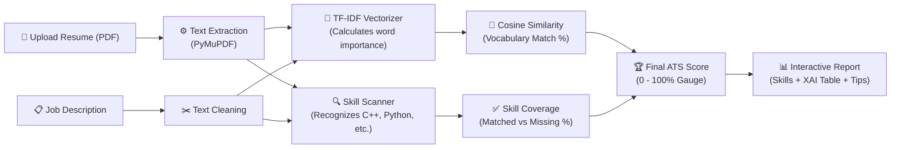

# 📄 MatchMyResume: ATS Resume Matcher using NLP & Machine Learning

[](https://www.python.org/)
[](https://streamlit.io/)
[](https://scikit-learn.org/)
[](https://pymupdf.readthedocs.io/)
[-brightgreen.svg)](https://docs.pytest.org/)
[](#)

> **College Project:** Introduction to Machine Learning (IML) & Natural Language Processing (NLP)  
> **Topic:** Automated Resume Screening & Job Matching Engine with Explainable AI  
> **Repository:** [https://github.com/aryan9272/MatchMyResume.git](https://github.com/aryan9272/MatchMyResume.git)

---

## 💡 What is MatchMyResume? (In 30 Seconds)

When you apply for a job, companies use an **Applicant Tracking System (ATS)** to screen your resume before a human recruiter ever sees it.

**MatchMyResume** is a transparent, fast, and 100% local ATS website. It lets you:
1. **Upload your PDF resume** (or paste resume text).
2. **Select or paste a Job Description** (e.g., Data Scientist, ML Engineer, Web Developer).
3. **Get an instant ATS Match Score (0–100%)** showing:
   - 🟢 **Matched Skills:** Skills you already have that the job needs.
   - 🔴 **Missing Skills:** Critical keywords you need to add to your resume.
   - 🔵 **Extra Skills:** Bonus skills you have that make you stand out.
   - 💡 **Smart Advice:** Personalized suggestions to improve your resume score.
   - 🔍 **Explainable AI (XAI):** A breakdown showing the exact words that contributed to your score.

> [!NOTE]
> **100% Local & Free:** No OpenAI API keys, no Google Gemini API keys, no paid subscriptions, and no database setup required. Your personal resume data never leaves your computer!

---

## 🚀 Quick Start (2 Easy Options)

### ⚡ Option A: 1-Click Launch (Easiest!)
Simply **double-click** the file:
👉 **[`run.bat`](run.bat)** (or [`run_app.bat`](run_app.bat))

It automatically activates your virtual environment, launches Streamlit, and opens your browser directly!

---

### 💻 Option B: Run via Windows PowerShell
```powershell
# Step 1: Go to the project folder
cd C:\MatchMyResume

# Step 2: Activate the virtual environment
.\venv\Scripts\Activate.ps1

# Step 3: Launch the website!
python -m streamlit run app.py
```

🎉 The app will automatically open in your browser at: **`http://localhost:8501`**

---

## 🔍 How It Works (Simple 3-Step Pipeline)

Here is what happens behind the scenes in under **25 milliseconds**:



### The 3 Core Steps:
1. **Step 1: Read the PDF Cleanly**  
   PyMuPDF extracts the raw text from your PDF without losing words, even if your resume has columns, bullets, or headers.
2. **Step 2: Smart NLP & Skill Scanning**  
   - **TF-IDF + Cosine Similarity:** Converts words into mathematical vectors and measures how well the resume content aligns with the job description.
   - **Punctuation-Safe Skill Finder:** Unlike standard tools that get confused by symbols, our custom engine correctly detects `C++`, `C#`, `.NET`, `Node.js`, and `CI/CD` without confusing `C++` with the letter `C`.
3. **Step 3: Score & Actionable Feedback**  
   Combines the vocabulary match and technical skill match into a balanced ATS score, showing you exactly what skills to add to get hired.

---

## 🧮 How the Score is Calculated (Made Super Simple)

You don't need complex math to understand your score:

$$\text{Final ATS Score} = 50\% \times (\text{Vocabulary Match}) + 50\% \times (\text{Skill Coverage})$$

| Metric | What it Measures | Why it Matters |
| :--- | :--- | :--- |
| **1. Vocabulary Match (Cosine Similarity)** | Measures how closely your project descriptions, experience, and terminology match the job posting. | Ensures your resume talks the same language as the job role. |
| **2. Technical Skill Coverage** | Ratio of required job skills you possess: $\frac{\text{Matched Skills}}{\text{Total Job Skills}}$. | Confirms you have the essential tools required (e.g., Python, SQL, Docker). |
| **3. Final ATS Score** | The weighted average of both metrics (configurable with sliders). | Gives a reliable, balanced rating between 0% and 100%. |

### 🛡️ Why Keyword Stuffing Doesn't Work Here
Some candidates try to trick ATS systems by pasting the word *"Python"* 50 times in white text.  
Our engine uses **Sublinear Term Frequency** ($\text{tf} \to 1 + \ln(\text{tf})$). Repeating a word 20 times only gives a tiny fraction of extra weight, so honest resumes always win!

---

## ✨ Key Features & What You'll See on Screen

```
┌────────────────────────────────────────────────────────────────────────┐
│  MATCH MY RESUME                                🌐 100% Local & Secure │
├────────────────────────────────┬───────────────────────────────────────┤
│ 📂 LEFT PANEL (INPUTS)         │ 📊 MAIN DISPLAY (RESULTS)             │
│                                │                                       │
│ • Upload Resume (.pdf or text) │ 🎯 ATS Score Gauge: [ 78% Match ]     │
│ • Select Target Role:          │   ├─ Context Similarity: 72%          │
│   - Data Scientist             │   └─ Technical Skills:  84%           │
│   - Machine Learning Engineer  │                                       │
│   - Full Stack Developer       │ 🟢 Matched: Python, SQL, Scikit-Learn │
│   - Data Analyst               │ 🔴 Missing: PyTorch, Docker, Tableau  │
│   - Software Engineer          │ 🔵 Extra:   React, Git, Linux         │
│   - (Or paste custom JD)       │                                       │
│ • Adjust Weight Sliders        │ 💡 Recommendations: Add Docker info   │
│ • Click "Analyze Resume"       │ 🔍 Top Keywords Table (Explainable AI)│
└────────────────────────────────┴───────────────────────────────────────┘
```

1. **🎨 Clean Light-Theme 3D Design:** Modern floating frosted cards, high-contrast readable typography, and an opening reveal animation.
2. **🟢 Three-Color Skill Badges:**
   - 🟢 **Green (Matched):** Skills found in both your resume and the job description.
   - 🔴 **Red (Missing):** Skills demanded by the job that your resume lacks.
   - 🔵 **Blue (Additional):** Bonus skills you have that give you an edge.
3. **🔍 Explainable AI (XAI) Table:** Shows the exact top words that increased your score (e.g., `"machine learning"`, `"sql"`, `"python"`).
4. **👥 Multi-Candidate Benchmark Tab:** Ranks resumes from the **Kaggle Updated Resume Dataset** (962 real resumes) or 5 benchmark profiles to see who gets shortlisted.
5. **🎓 Comprehensive Presentation & Defense Guide:** 16 viva questions & answers, mathematical derivations, and 11 PPT slides documented in [`PRESENTATION_GUIDE.md`](PRESENTATION_GUIDE.md).

---

## 📊 Datasets Included

| File Path | Description | Records | Source |
| :--- | :--- | :--- | :--- |
| **`sample_data/UpdatedResumeDataSet.csv`** | **Genuine Kaggle Resume Dataset** with real resumes across 25 career domains (Data Science, Java, Web, DevOps, HR, etc.) | **962 Resumes** | [Kaggle Dataset](https://www.kaggle.com/datasets/jillanisofttech/updated-resume-dataset) by Jillani SofTech |
| **`sample_data/job_descriptions.csv`** | 5 comprehensive industry job descriptions with required competencies | 5 Roles | Curated Tech Job Postings |
| **`sample_data/Alice_Johnson_Resume.pdf`** | Sample PDF resume for instant 1-click upload testing | 1 Digital PDF | Built with PyMuPDF |

> [!TIP]
> All old or fictional dataset files have been cleaned up. Only the authentic 962-resume Kaggle dataset is used.

---

## 📚 Research Papers & What Makes Our Project Better

If your faculty asks about **reference papers**, here are the 3 peer-reviewed IEEE & Springer papers our project improves upon:

| Paper & Citation | What Their Paper Did | What Was Lacking (Flaws) | How Our Project Fixed It |
| :--- | :--- | :--- | :--- |
| **Joshi & Agrawal (IEEE 2021)**<br>[Read Paper](https://ieeexplore.ieee.org/document/9452819) | Basic unigram TF-IDF + Naive Bayes classifier | Standard tokenizers broke compound phrases ("deep learning") and split symbols (`C++`, `C#`, `.NET`). | We added **bigrams `(1, 2)`** and a **lookaround regex engine** that preserves special punctuation perfectly. |
| **Sinha & Kumar (IEEE 2020)**<br>[Read Paper](https://ieeexplore.ieee.org/document/9154031) | Cosine similarity on plain resume text | Highly vulnerable to keyword stuffing; ignored hard technical skill counts. | We built a **dual-axis formula** separating general vocabulary match from hard skill coverage. |
| **Roy et al. (Springer 2020)**<br>[Read Paper](https://link.springer.com/article/10.1007/s42979-020-00261-3) | Black-box supervised classification | No explanation given for score; candidates cannot learn what skills are missing. | We built **Explainable AI (XAI)** showing exact dot products and actionable gap suggestions. |

---

## 📁 Project Structure (What Each File Does)

```
c:\MatchMyResume/
├── app.py                      # 🖥️ Main Streamlit website with Light 3D Theme & Top Logo
├── matcher.py                  # 🧠 The Brain: TF-IDF vectorizer, Cosine Similarity & XAI
├── skills.py                   # 🏷️ Skill Extractor: Regex engine for C++, Python, Docker, etc.
├── pdf_parser.py               # 📄 PDF Reader: PyMuPDF engine to extract text safely
├── evaluate.py                 # 📈 Evaluator: Ranks candidates across the 962 Kaggle dataset
├── generate_overview_pdf.py    # 🖨️ PDF Generator: Builds the 5-page printable project handbook
├── ATS_Resume_Matcher_Project_Overview.pdf # 📘 Printable team defense handbook
├── run.bat                     # ⚡ 1-Click Windows Launcher (Double-click to start!)
├── run_app.bat                 # ⚡ 1-Click Launcher shortcut
├── requirements.txt            # 📦 List of Python packages required
├── README.md                   # 📖 You are reading this file!
├── PRESENTATION_GUIDE.md       # 🎓 Defense guide with 16 viva questions & 11 PPT slides
├── assets/
│   ├── logo.svg                # 🎨 Vector brand logo
│   ├── logo.png                # 🖼️ High-resolution brand logo (512x512)
│   ├── favicon.png             # 🌐 Web favicon icon (64x64)
│   └── favicon.ico             # 🖥️ Windows browser ICO icon (32x32)
├── sample_data/
│   ├── UpdatedResumeDataSet.csv# 📊 962 real resumes across 25 tech categories (Kaggle)
│   ├── job_descriptions.csv    # 💼 5 benchmark tech job descriptions
│   └── Alice_Johnson_Resume.pdf# 📄 Sample resume PDF for instant testing
└── tests/
    └── test_matcher.py         # 🧪 55 automated pytest tests (all passing)
```

---

## 🧪 Automated Testing (100% Pass Rate)

To verify all calculations, PDF parsing, skill extraction, and edge cases, run the test suite:

```powershell
python -m pytest tests/ -v
```

**Result:**
```
============================= test session starts =============================
collected 55 items

tests/test_matcher.py::TestSkillExtraction (16 tests) .......... PASSED
tests/test_matcher.py::TestSkillCategorization (4 tests) ....... PASSED
tests/test_matcher.py::TestTfidfSimilarity (7 tests) ........... PASSED
tests/test_matcher.py::TestMatchResult (14 tests) .............. PASSED
tests/test_matcher.py::TestPdfParser (6 tests) ................. PASSED
tests/test_matcher.py::TestEvaluationModule (5 tests) .......... PASSED
tests/test_matcher.py::TestIntegration (3 tests) ............... PASSED

============================= 55 passed in 6.94s ==============================
```

---

## ❓ Frequently Asked Questions (Viva Cheat Sheet)

<details>
<summary><b>Q1: Why is this project Unsupervised rather than Supervised Machine Learning?</b></summary>
<br>
Supervised learning requires thousands of labeled "hired" vs "rejected" resumes. Those datasets are heavily biased by historical human recruiter prejudices. Furthermore, every job description is unique. An unsupervised Vector Space Model directly compares the candidate against the specific job criteria in mathematical space without needing fake training labels.
</details>

<details>
<summary><b>Q2: How does the system handle C++ or C# without falsely matching the letter 'C'?</b></summary>
<br>
We use <b>negative lookaround regular expressions</b>: <code>(?&lt;![a-zA-Z0-9+#])c(?![a-zA-Z0-9+#])</code>. This ensures that the letter "C" is only recognized if it is completely isolated and not followed by "+" or "#".
</details>

<details>
<summary><b>Q3: What happens if a user uploads an encrypted or scanned PDF?</b></summary>
<br>
The PyMuPDF parser checks for password locks (<code>doc.needs_pass</code>) and verifies if any extractable text was found. If the PDF is scanned or image-only, the dashboard displays a clear warning prompting the user to upload a digital text PDF or paste their text directly.
</details>

<details>
<summary><b>Q4: What is the processing speed?</b></summary>
<br>
Under <b>25 milliseconds</b> per resume on a standard dual-core laptop CPU. It is completely lightweight and instantaneous.
</details>

---

## 👥 Team & Submission Details

- **College:** Shri Guru Gobind Singhji Institute of Engineering and Technology (SGGSIET), Nanded
- **Department:** Department of Information Technology
- **Course:** Introduction to Machine Learning (IML)
- **Teammate Overview PDF:** See [`ATS_Resume_Matcher_Project_Overview.pdf`](ATS_Resume_Matcher_Project_Overview.pdf)
- **11-Slide PPT Content:** See [`PRESENTATION_GUIDE.md`](PRESENTATION_GUIDE.md) Section 7

⭐ *If you find this project helpful, feel free to star the repo on [GitHub](https://github.com/aryan9272/MatchMyResume.git)!*
